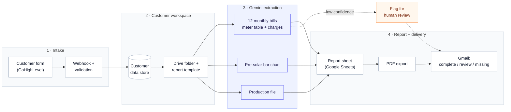

<picture>
  <source media="(prefers-color-scheme: dark)" srcset="https://raw.githubusercontent.com/ubakel/ubakel/main/assets/repo-header-dark.png">
  
</picture>

# Solar Report Automation

A pipeline that turns a customer's utility-bill PDFs into a filled-in solar performance report. A customer submits a form with twelve monthly bills, a pre-solar usage bill and a production file. The system reads the bills with an AI model, writes only trustworthy figures into a report sheet, exports the sheet as a PDF, and emails the business owner. Anything it cannot read reliably is flagged for a human instead of guessed.

Built for a US solar business.

<picture>
  <source media="(prefers-color-scheme: dark)" srcset="https://raw.githubusercontent.com/ubakel/ubakel/main/assets/divider-dark.png">
  
</picture>

## Architecture

## How a submission flows

1. **Form intake.** A form submission triggers a webhook.
2. **Validation.** A submission missing the customer's email, phone number or first name is ignored, and the operations inbox is told. Nothing is created.
3. **A workspace per customer.** A first submission creates a Drive folder and a copy of the report template. A returning customer reuses theirs, found through a lookup table.
4. **Bills in.** Each bill is downloaded, stored in the customer's folder, and sent to Gemini for structured extraction.
5. **Report filled.** Accepted figures are written into the report sheet's monthly cells.
6. **Pre-solar year.** The previous year's usage is read from a bar chart on the pre-solar bill.
7. **Production file.** The customer's solar production figures are read and kept for the report.
8. **Export and notify.** The sheet is exported as a PDF and emailed with a status: complete, needs review, or missing months.

## Design decisions

- **A wrong number is worse than a missing one.** The extraction prompt says so directly and requires a confidence rating. Low confidence means the figure is left out and flagged for review.
- **Use the meter table, then cross-check.** The prompt reads the bill's meter reading table first and falls back to itemised charge lines. If both are present and disagree, it trusts the meter table, lowers confidence and states both numbers.
- **Name the traps.** The prompt lists figures that look like monthly totals but are not, such as average daily usage tiles, so the model is told to ignore them.
- **Only write complete data.** The pre-solar column is written only when all twelve months were read. Otherwise it stays empty and a person is emailed.
- **Newest bill wins, per month.** The system remembers which year it holds for each month. A new bill is accepted only for a month it lacks or for a newer year, so a re-upload cannot overwrite better data with older data.
- **Bind to one account.** The customer's utility account is stored only when exactly one account has been seen on their bills.
- **Handle mistakes politely.** If months are missing, the customer gets an email asking them to resubmit, with a tip that a PDF downloaded from the utility works better than a photo.
- **Fail loudly.** Most download, Drive, Sheets and AI steps have their own error handling, and each run carries a run ID for logging.

## Stack

| Layer | Tools |
|---|---|
| Intake | GoHighLevel form, webhooks |
| Orchestration | Make.com |
| AI extraction | Gemini (structured extraction from PDFs and chart images) |
| Documents | Google Drive, Google Sheets (template copy, PDF export) |
| State | Make data store (customer lookup, per-month year tracking, account binding) |
| Notifications | Gmail |

<picture>
  <source media="(prefers-color-scheme: dark)" srcset="https://raw.githubusercontent.com/ubakel/ubakel/main/assets/divider-dark.png">
  
</picture>

  Built by <a href="https://ubakel.com"><b>Ubakel</b></a> &nbsp;·&nbsp; AI &amp; Automation for Business Operations &nbsp;·&nbsp; <a href="https://ubakel.com/contact/">Start with a free workflow audit</a>

